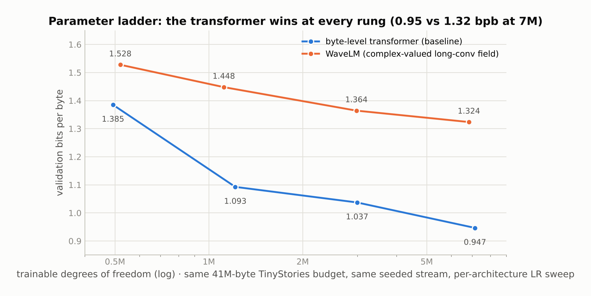
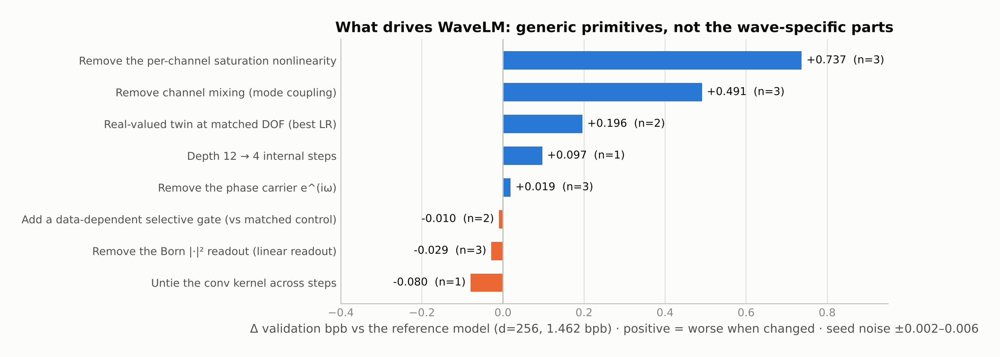

# WaveLM — a complex-valued byte-level language model, and the ablation study that measured what actually drives it

WaveLM is a byte-level language model whose state is a complex-valued field advanced by twelve internal steps of {dilated causal convolution → low-rank channel mixing → per-channel saturating nonlinearity → phase rotation → energy normalisation}, read out through a squared-magnitude ("Born rule") projection. It was designed from a wave/interference metaphor. It is a real language model: a 7.35M-parameter instance reaches **2.30 bits per byte on The Pile** from a cold start and generates register-appropriate English. It also **loses to a byte-level transformer at every size on a matched ladder**, and a controlled ablation campaign shows that what drives it is a pointwise nonlinearity, channel mixing and depth — generic primitives — while the wave-specific parts are minor or slightly harmful.

This repository is published as a negative result with its instruments: the model, the matched baseline harness, the ladder, the ablations, every run's metrics, and the write-ups that reached the conclusion.



## Headline numbers

| Measurement | Value | Artifact |
|---|---|---|
| The Pile, byte-level, 7.35M params, cold start, 12,000 steps (~295M bytes seen) | **2.298 bpb** on the full validation set (per-byte perplexity 4.92); 2.353 bpb at the last in-training eval | `results/runs/wavelm_pile_42/metrics.jsonl`, `results/logs/wavelm_pile_42.log`, `results/RESULTS_LOG.md` |
| TinyStories, byte-level, ~1.0M params with mode coupling | **1.355 bpb** full-validation; coherent children's-story prose | `results/runs/wavelm_run3/metrics.jsonl`, `results/logs/wavelm_run3.log` |
| Parameter ladder vs a byte transformer (0.5M → 7M DOF, same 41M-byte budget, same seeded stream, per-architecture learning-rate sweep) | WaveLM **1.528 / 1.448 / 1.364 / 1.324** bpb; transformer **1.385 / 1.093 / 1.037 / 0.947** — the transformer wins at all four rungs; fitted per-parameter exponents 0.39 vs 0.90 | `results/compare/compare_results.json` |
| Ablation campaign (40 runs, 2 widths, up to 3 seeds, matched budget) | saturation removed **+0.74 bpb**; channel mixing removed **+0.49**; real-valued twin at matched DOF **+0.20**; phase carrier removed **+0.02**; Born readout removed **−0.03** (better) | `results/ablation/ablation_results.json`, [`docs/12_performance_drivers_and_first_principles.md`](docs/12_performance_drivers_and_first_principles.md) |

Reference points for byte-level TinyStories (from the repository's own logs): uniform 8.0, byte-unigram ≈4.5, byte-bigram ≈2.5. For byte-level Pile, an interpolated-backoff byte-trigram model trained on 200 MB of the same stream scores ≈3.30 bpb held-out, so 2.30 is well past n-gram territory; a well-tuned large Pile model is around 1.0–1.2 bpb.

## What drives it



Stripped of the metaphor, one internal step is five operations on a complex field ψ ∈ ℂ^{T×d}: a dilated causal depthwise complex convolution (an LTI long-conv / state-space-style operator), a low-rank complex channel mix, a radial saturating nonlinearity `p / (1 + g|p|²)`, a per-channel phase rotation `e^{iω}`, and an L2 energy renormalisation. The campaign in [`docs/12`](docs/12_performance_drivers_and_first_principles.md) trained a reference model and one-thing-changed variants to an identical budget through the same training loop and found:

* **Fundamental:** the pointwise nonlinearity (+0.74 bpb when removed — the model collapses toward the bigram ceiling), channel mixing (+0.49), and iterated depth (12 → 4 steps, +0.10).
* **Real but small:** the complex-valued representation as a package (+0.20 vs a real-valued structural twin at matched degrees of freedom) — but the benefit lives in the complex convolution and mixing, not in the nominal carrier frequencies.
* **Decorative or in the way:** the phase carrier (+0.019, shrinking to +0.008 at d=512) and the Born |·|² readout, which *hurts* (removing it improves bpb by 0.03 at d=256 and 0.04 at d=512).
* **Under-used levers:** untying the conv kernel across steps (−0.08, the largest single win) and a minimal data-dependent selective gate (−0.01 to −0.02 vs a parameter-matched control, growing with scale).

The structural reason for the ladder result is that WaveLM is essentially a linear time-invariant system with one weak radial nonlinearity and a quadratic readout: it has no data-dependent routing, which is the property that powers both attention and selective state-space models. Seed noise in the campaign is ±0.002–0.006 bpb for the well-behaved variants, so differences above 0.01 are real; single-seed rows are marked n=1 in the figure.

## Baseline fairness, stated plainly

The ladder (`baselines/harness.py`, `scripts/run_compare.py`) trains both architectures on the same seeded byte stream, matches trainable degrees of freedom within ±2% per rung, sweeps the learning rate per architecture, and uses the same optimiser, schedule and precision. Two limitations: depth is not matched (WaveLM's internal depth is fixed at 12 steps; the transformer's layer count is set by the parameter target, and at the 0.5M rung the baseline is a single transformer layer), and the ladder is single-seed per rung (seed variation was measured separately at ±0.002–0.007). Both limitations, if anything, understate the transformer's advantage at the small end.

## Repository layout

```
wave/            the model: config, field dynamics, readout, data, training, streaming inference, real-valued twin
baselines/       the byte-level transformer baseline and the shared, seeded training harness used by every comparison
tools/           parameter/DOF budgeting
scripts/         train_wave.py · eval_wave.py · generate_wave.py · chat_wave.py · run_compare.py (ladder) · ablation_study.py / analyze_ablation.py · prepare_pile_bytes.py
tests/           unit tests for the field dynamics, gradients (finite-difference checks), budget accounting, ablation switches and the baseline
docs/            design (00–03), the as-built record (04), results (05), the transformer comparison (11) and the driver analysis (12)
results/         every run's metrics.jsonl, the ladder and ablation JSON, training logs, generation samples, and the running results log
figures/         the figures in this README
```

Read [`docs/12`](docs/12_performance_drivers_and_first_principles.md) and [`docs/11`](docs/11_transformer_comparison.md) first; they are the conclusions. `docs/00` and `docs/01` are the design as intended and are superseded by the measurements wherever the two disagree ([`docs/04`](docs/04_as_built.md) records each divergence and why). The design documents refer to an earlier predecessor model as "AIFS"; it is not part of this repository.

## Reproduce

```bash
pip install -e ".[test]"
python -m pytest tests -q
# byte-level Pile cache: detokenizes the 250M-token GPT-2 cache produced by the DPNCA-LM repo back to UTF-8 bytes
PILE_TOKEN_CACHE=/path/to/pile_250M_gpt2.pt python scripts/prepare_pile_bytes.py
# the 7.35M Pile run (~8.6 h on a 16 GB GPU); the run's header in results/logs/wavelm_pile_42.log records the configuration
python scripts/train_wave.py --train_txt data/pile/train.txt --val_txt data/pile/val.txt --d 2048 --T 1024 --n_sub 16 --delta 2 \
    --mix_channels --mix_rank 96 --steps 12000 --batch 24 --lr 1e-4 --seed 42 --ckpt_dir checkpoints/wavelm_pile_42
python scripts/run_compare.py                                 # the parameter ladder, both architectures (~4 h)
python scripts/ablation_study.py && python scripts/analyze_ablation.py   # the driver campaign (~2 h)
```

Hardware for every number here: one RTX 4080 SUPER (16 GB).

## License

MIT.
